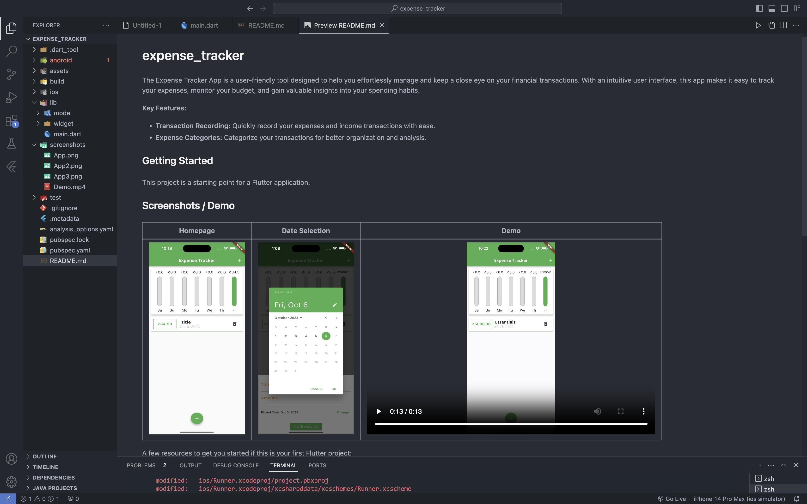

# app_cardibascular

# 🫀 Sistema de Gestión Cardiovascular

Aplicación móvil desarrollada con Flutter y Dart, utilizando GetX para la gestión del estado y la organización de la lógica de la aplicación.

## 📌 Descripción del proyecto

El Sistema de Gestión Cardiovascular es una aplicación móvil orientada al seguimiento y análisis de indicadores relacionados con la salud cardiovascular del usuario.

Su finalidad es permitir el registro y seguimiento de mediciones cardiovasculares, visualizar su evolución mediante gráficas y proporcionar alertas que ayuden a identificar posibles señales de riesgo o alteraciones en los indicadores registrados.

La aplicación busca facilitar el monitoreo de estos datos y brindar información que permita al usuario estar más atento a su salud cardiovascular.

Importante: La aplicación tiene fines de seguimiento y orientación; sus resultados no sustituyen un diagnóstico ni una evaluación médica profesional.


## Tecnologías utilizadas
- Flutter / Dart
- GetX (estado, rutas e inyección de dependencias)
- Google Sign-In (autenticación)
- Google Drive API (almacenamiento de datos)
- fl_chart (gráficas)

## Arquitectura
El proyecto sigue una separación por capas:
presentation → application → data → models
Las vistas solo muestran información, los controllers manejan el estado,
y los servicios/repositorios acceden a los datos externos.

## 🚀 Tecnologías utilizadas

- **Flutter:** Framework para el desarrollo multiplataforma.
- **Dart:** Lenguaje de programación.
- **GetX:** Gestión de estado, dependencias y navegación.
- **Git:** Control de versiones.
- **GitHub:** Alojamiento del repositorio.

## 📂 Estructura del proyecto

```bash
lib/
├── main.dart
├── assets
│   └──docs
│   └──images
├── models/
│   └── registro_model.dart
├── data/
│   ├── services/
│   │   ├── auth_service.dart
│   │   └── drive_service.dart
│   └── repositories/
│       └── registro_repository.dart
├── application/
│   ├── bindings/
│   │   └── initial_binding.dart
│   ├── controllers/
│   │   ├── login_controller.dart
│   │   ├── home_controller.dart
│   │   └── graficas_controller.dart
│   └── routes/
│       ├── app_routes.dart
│       └── app_pages.dart
└── presentation/
    ├── login_page.dart
    ├── home.dart
    ├── graficas_page.dart
    └── widgets/
        ├── grafica_rueda.dart
        ├── grafica_lineal.dart
        └── tarjeta_dato.dart
```


## ⚙️ Requisitos previos

Antes de ejecutar el proyecto, debes tener instalado:

- Flutter SDK.
- Dart SDK (incluido con Flutter).
- Android Studio o Visual Studio Code.
- Git.

## 📥 Instalación

1. Clonar el repositorio:

```bash
git clone https://github.com/Twokarma/Dsipos_moviles_cardio_vascular.git
```


2. Ingresar al directorio de la aplicación:

```bash
cd Dsipos_moviles_cardio_vascular/app_cardibascular
```


3. Instalar las dependencias:

```bash
flutter pub get
```

## ▶️ Ejecución

Ejecutar la aplicación con:

```bash
flutter run
```

Para generar un APK:

```bash
flutter build apk --release
```

## 📸 Capturas de pantalla



## 👥 Autores

- [Nombre del integrante 1]
- [Nombre del integrante 2]

## 📄 Licencia

Proyecto desarrollado con fines académicos.